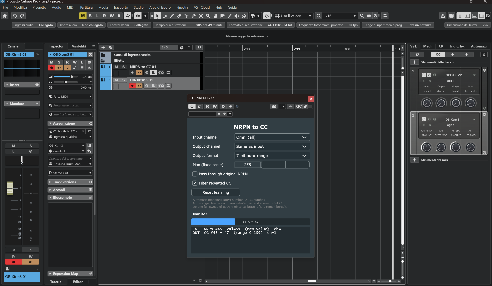

# NRPN to CC — VST3 

A VST3 plugin (VST3 only) of type **instrument (VSTi)** that receives MIDI, **passes through**
everything that is not NRPN, and **converts NRPN messages into CC**, sending the result to its
MIDI output.

> **Why an instrument and not a "MIDI effect"?** Cubase does **not** load VST3 MIDI-effect
> plugins in its MIDI Insert slots (those accept only Cubase's native MIDI plug-ins), and as an
> audio insert it would not receive the track's MIDI. An **instrument**, instead, is fed the
> whole MIDI stream of the track: so the plugin receives the NRPN messages and can emit the CC
> on its output, which you route to a virtual instrument or an external MIDI track. As a bonus,
> the controller's MIDI port is opened by Cubase, not by the plugin: no port conflict.

## Two ways to get it

| | **Build it yourself** — free | **Install and play** — ready-made package |
|---|---|---|
| What you get | The source code in this repository | A Windows installer and the illustrated user manual (PDF) |
| Installation | Build with free developer tools (see [Building](#building)) and copy the `.vst3` by hand | Setup (English or Italian) puts the plug-in in the right VST3 folder; clean removal from Windows Settings |
| Documentation | This README | The user manual: installation, Cubase setup step by step, every control, troubleshooting. The **Manual** button of the plug-in opens it |
| Support | — | By email |
| Where | Here, on GitHub | [gprmusic.com/product/nrpn-to-cc](https://www.gprmusic.com/product/nrpn-to-cc/) |

**If you don't want to compile the plug-in**, buy the ready-made package:

1. Open the product page: **https://www.gprmusic.com/product/nrpn-to-cc/**
2. Click **Add to cart**, then go to checkout and pay.
3. After payment you receive an email with the download links of the installer and of the user
   manual. The links are valid for **7 days**: download the files and keep a copy.
4. Unzip the installer, close your DAW and run `NRPN-to-CC_<version>_Setup.exe`, then rescan the
   VST3 plug-ins in your DAW. The **Manual** button in the plug-in window opens the user manual.

Buying the package also supports the development of new plug-ins. The plug-in itself is the
same in both cases, and it stays free software under the GPL v3.

## What it does

- Receives NRPN (CC 99/98 = parameter number, CC 6/38 = value).
- Generates a CC with **automatic mapping**: `CC number = NRPN parameter number` (low 7 bits).
- From the interface you can set:
  - **Input channel** (Omni or 1–16): which channel to listen to.
  - **Output channel** (Same as input or 1–16).
  - **Output format**:
    - `7-bit auto-range` (default) → a single CC. The plugin **learns**, per NRPN (and per
      channel), the maximum value it receives and scales it to **0–127**. Generic, with no
      device-specific tables: **switches** (max 1) become 0/127, **knobs** become a smooth
      0–127. Do **one full sweep** of each knob to calibrate it; the learned ranges are
      **saved in the project**. The **Reset learning** button clears them.
    - `7-bit fixed scale` → a single CC scaled with a fixed maximum (**Max (fixed scale)**),
      useful when you know the range and want deterministic behavior.
    - `14-bit (MSB+LSB)` → two CCs: `CC#n` = MSB and `CC#n+32` = LSB (high resolution).
  - **Max (fixed scale)**: used only by the "fixed scale" mode.
  - **Pass through original NRPN**: if enabled, the raw NRPN messages are forwarded too, in
    addition to the CC.
  - **Filter repeated CC** (default ON): in 7-bit mode, avoids sending consecutive CCs with the
    same value (useful because scaling 0–255 → 0–127 makes many steps map to the same CC).
  - **Monitor**: shows the last NRPN received, the CC sent, and a **bar** of the outgoing CC value.
  - **Manual**: opens the illustrated user manual that comes with the
    [installer package](https://www.gprmusic.com/product/nrpn-to-cc/). In a build from source,
    where the manual is not installed, it says where the manual would be.

> Note on **MIDI ports**: a VST3 plugin inserted in a track does not open hardware ports. The
> physical port (your MIDI interface) is chosen in the **DAW's track routing**. In the plugin
> you choose the **channel**; the port is handled by Cubase.

---

## Usage scenario

The screenshot below shows the typical setup in Cubase Pro:



1. Create an **instrument track** and load **NRPN to CC** on it (*NRPN to CC 01* in the
   screenshot). Set this track's **MIDI input** to the instrument/controller whose NRPN messages
   you want to translate (e.g. your hardware synth, or "All MIDI Inputs"), and enable input
   monitoring so the MIDI reaches the plugin.
2. Create a **second track** hosting the **target instrument** — another virtual instrument
   (VSTi) or an external device (*OB-Xtrm3 01* in the screenshot).
3. Set the **target track's MIDI input** to **NRPN to CC**'s MIDI output. The signal flow becomes:
   `source → NRPN to CC → target instrument`.
4. Non-NRPN messages pass through untouched; NRPN messages are converted to CC (in the screenshot
   NRPN #45 → CC #45), so the target instrument receives standard CC it can map or MIDI-learn. The
   **Monitor** shows the live conversion.

This example uses Cubase, but the **same approach works in any DAW**: host NRPN to CC as an
instrument, feed it the source MIDI, and route its MIDI output to the target instrument/track.

---

## Prerequisites (Windows)

> **Don't want to compile?** The [ready-made package](https://www.gprmusic.com/product/nrpn-to-cc/)
> has a Windows installer and the user manual: see [Two ways to get it](#two-ways-to-get-it).

You need a C++ compiler and CMake:

1. **Visual Studio 2022 or later, Community edition** (free) — during installation select the
   **"Desktop development with C++"** workload. It includes the MSVC compiler, the Windows SDK
   and the "C++ CMake tools" (hence CMake).
   Download: https://visualstudio.microsoft.com/downloads/
2. **Git**.

(Alternatively you can install CMake standalone from https://cmake.org/download/ plus the Build
Tools for Visual Studio, but the full IDE is the simplest route.)

---

## Building

Open the **"Developer PowerShell for VS"** (from the Start menu) and go to the project folder:

```
cd "path\to\NrpnToCc"
```

Configure (the first time this downloads JUCE automatically: a few minutes):

```
cmake -B build -G "Visual Studio 17 2022" -A x64
```

> On Visual Studio 2026 use the generator `"Visual Studio 18 2026"` instead.

Build in Release:

```
cmake --build build --config Release
```

The compiled plugin is at:

```
build\NrpnToCc_artefacts\Release\VST3\NRPN to CC.vst3
```

---

## Installation

With the [installer package](https://www.gprmusic.com/product/nrpn-to-cc/), run the Setup and
you are done. With your own build, read on.

The build does **not** copy the plugin automatically. Copy the `NRPN to CC.vst3` folder into one
of these locations:

- `C:\Program Files\Common Files\VST3`  (all users — requires admin)
- `%LOCALAPPDATA%\Programs\Common\VST3`  (current user only — no admin)

---

## Using it in Cubase (recommended routing: instrument rack)

Goal: **controller → plugin → (pass-through + CC) → virtual instrument / external instrument.**

1. Rescan the VST3 plugins (Studio → VST Plug-in Manager → Update). The plugin appears among the
   **instruments** (Instrument), not among the inserts.
2. Open the **instrument rack**: `Studio → VST Instruments` (**F11**).
   Add **NRPN to CC**. When Cubase asks to create an associated MIDI track, accept.
3. **"IN" track** (the one created in step 2, pointing at the plugin):
   - MIDI input = your controller (or "All MIDI Inputs").
   - Enable **Monitor** (the speaker icon) or record-enable, so MIDI reaches the plugin.
   - Open the plugin GUI: when the controller sends NRPN, the **Monitor** must light up.
4. **Enable the plugin's MIDI output**: in the instrument rack, on the NRPN to CC slot, enable
   the plug-in MIDI output (in many versions there is a small "MIDI Out"/connector control on the
   slot; its position varies with the Cubase version).
5. **"OUT" track** (new MIDI track):
   - MIDI input = **NRPN to CC** (the plugin's MIDI output now appears in the input list).
   - MIDI output = the desired destination: a **virtual instrument** (another instrument track)
     or an **external MIDI port** (hardware synth).
   - Enable **Monitor** on this track so the converted stream reaches the destination.

Final flow: `controller → IN track → NRPN to CC → OUT track → instrument/hardware`.

**Cubase 15 Pro** — specific notes:
- Use the **rack** (F11), not a plain instrument track: only the rack instance reliably exposes
  the plugin's MIDI output as a selectable *input* on another track.
- In Cubase 15 the instrument's MIDI output appears **automatically** among the MIDI inputs: no
  global switch is needed.
- If "NRPN to CC" does not appear among the inputs in step 5: close/reopen the routing window or
  reload the project after adding the instrument in the rack.

### MIDI behavior

- **Notes, pitch bend, regular CC, etc.** → pass through unchanged.
- **NRPN** (CC 99/98/6/38) → converted to **CC** (automatic mapping: NRPN number → CC number).
- Raw NRPN messages are **absorbed** (not forwarded), unless you enable *Pass through original
  NRPN* in the GUI.

---

## Project structure

```
NrpnToCc/
├─ CMakeLists.txt          # VST3-only build, downloads JUCE via FetchContent
├─ LICENSE                 # GNU GPL v3
├─ Resources/
│  └─ gpr-logo-horizontal.svg  # GPR music project logo, embedded in the GUI
└─ Source/
   ├─ PluginProcessor.h/.cpp   # NRPN -> CC logic
   ├─ PluginEditor.h/.cpp      # interface (channels, modes, monitor)
   └─ BrandLookAndFeel.h       # GPR music project colours and widget style
```

---

## License

This project is distributed under the **GNU General Public License v3.0** (see [LICENSE](LICENSE)).

The plugin is built with [JUCE](https://juce.com), used under its **GPLv3** license. As a result
this project is released as GPLv3 free software. JUCE is **not** included in the repository: it is
downloaded automatically by CMake (FetchContent) at build time.

The GPR music project name and logo (`Resources/gpr-logo-horizontal.svg`) identify the author and
are not licensed under the GPL: if you distribute a modified version, remove them.

© GPR Music Project.
